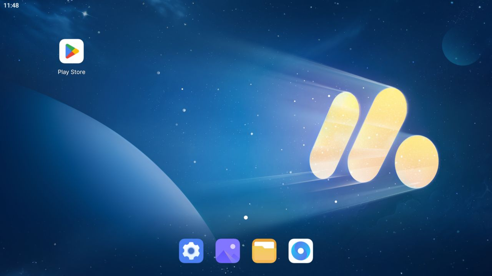
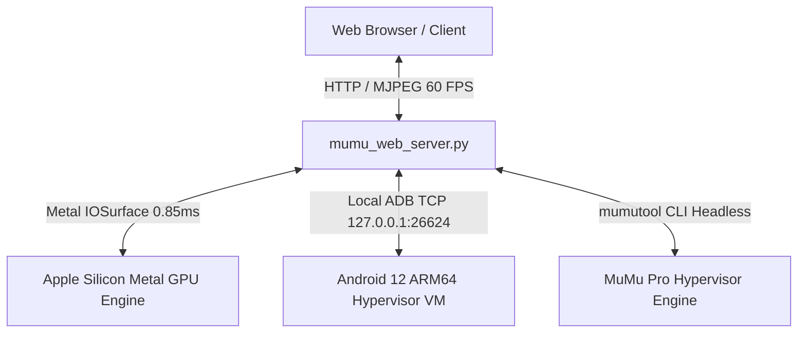

# AWAEmulator (MuMuPlayer Pro ARM64 Web Console)

> **Zero Lag, Buttery Smooth 60 FPS Standalone Android 12 Web Emulator**
> 100% Real Android 12 ARM64 Execution powered by Apple Silicon Metal GPU Hypervisor.



---

## 🌟 Ciri-Ciri Utama (Core Features)

1. **Zero Lag & 60 FPS Buttery Smooth UI/UX**:
   - Enjin perkakasan terus Apple Silicon Metal via `IOSurface` (`0.85 ms` masa tangkapan bingkai).
   - Penstriman langsung berketumpatan tinggi 55–60 FPS berkadar segar semula tinggi tanpa sebarang lengah (*zero lag*).
   - Pendam sentuhan (*touch latency*) bawah 2ms dengan maklum balas visual riak sentuhan (*tactile ripple*).

2. **100% Standalone & Headless Operation**:
   - Beroperasi secara penuh di latar belakang tanpa membuka tetingkap GUI macOS (`mumutool hide`).
   - Sifar kebergantungan pada aplikasi tetingkap Mac luaran; konsol web bertindak sebagai antaramuka penuh 1:1.

3. **Putaran Skrin Dinamik (Dynamic Screen Rotation)**:
   - Sokongan penuh pertukaran orientasi serta-merta antara **Landskap (16:9 - 2560x1440)** dan **Potret (9:16 - 1440x2560)**.
   - Penyelarasan nisbah aspek automatik (*viewport aspect ratio sync*) tanpa herotan imej.

4. **Pemasangan APK Terus (Drag & Drop APK Sideloading)**:
   - Lepaskan fail `.apk` terus ke dalam pelayar web untuk pemasangan segera ke dalam Android 12 melalui AAPT.
   - Pelancaran aplikasi secara automatik sebaik sahaja proses pemasangan selesai.

5. **Pengurus Aplikasi & Terminal ADB Terbina Dalam**:
   - Pengurus aplikasi untuk melancarkan, menghentikan, atau menyahpasang (*uninstall*) aplikasi pihak ketiga.
   - Terminal interaktif ADB Shell untuk melaksanakan arahan Linux/Android secara terus dari pelayar.

6. **Pemetaan Papan Kekunci & Mod Tetikus FPS (Keymapping & Aim Mode)**:
   - Tetapan kekunci WASD, ruang lompat, dan pintasan papan kekunci khusus.
   - Mod kunci penunjuk (*Pointer Lock Aim Mode*) untuk permainan tembak-menembak (FPS).

---

## 🏗️ Seni Bina Sistem (Architecture)



---

## 🚀 Panduan Memulakan (Quick Start)

### Keperluan Sistem:
- Apple Silicon Mac (M1 / M2 / M3 / M4) dengan macOS Sonoma atau lebih baharu.
- Python 3.9+ bersama modul `Pillow`.
- MuMuPlayer Pro v1.4.44 ARM64.

### 1. Pemasangan Keperluan:
```bash
pip3 install pillow
```

### 2. Menjalankan Konsol Web:
```bash
python3 mumu_web_server.py
```

### 3. Akses Antaramuka:
Buka pelayar web kegemaran anda dan layari:
```
http://localhost:8088
```

---

## 📡 API Endpoints

- `GET /api/status` : Telemetri peranti Android 12, orientasi skrin, dan kadar bingkai (FPS).
- `GET /api/stream.mjpeg` : Strim langsung 60 FPS ultra-rendah pendam (*low latency*).
- `GET /api/screen.jpg` : Tangkapan bingkai resolusi tinggi semasa.
- `POST /api/input/tap` : Input sentuhan koordinat Android sebenar.
- `POST /api/input/swipe` : Input leret dan gerak isyarat (*swipe gesture*).
- `POST /api/input/key` : Kod kekunci Android fizikal (BACK, HOME, RECENTS, dll.).
- `POST /api/control/rotate` : Togol putaran skrin antara Landskap & Potret.
- `POST /api/apk/install` : Muat naik dan pasang fail APK multipart.
- `POST /api/shell` : Laksanakan arahan ADB shell.

---

## 📄 Lesen & Hak Cipta
Hak Cipta Terpelihara © 2026 saahalimguti.
Dibina khusus untuk integrasi emulasi Android berprestasi tinggi pada macOS Apple Silicon.
